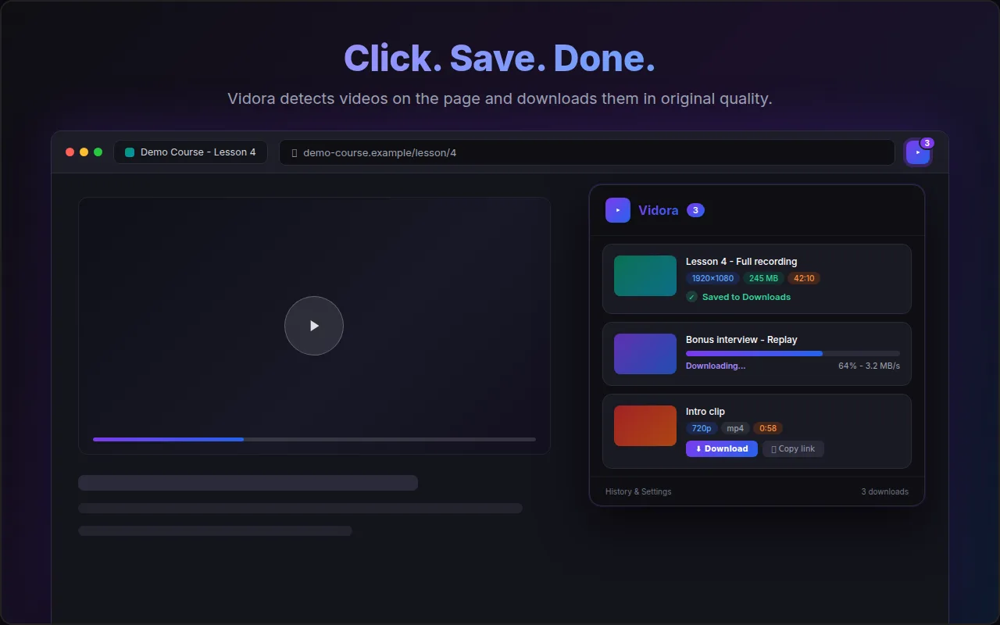
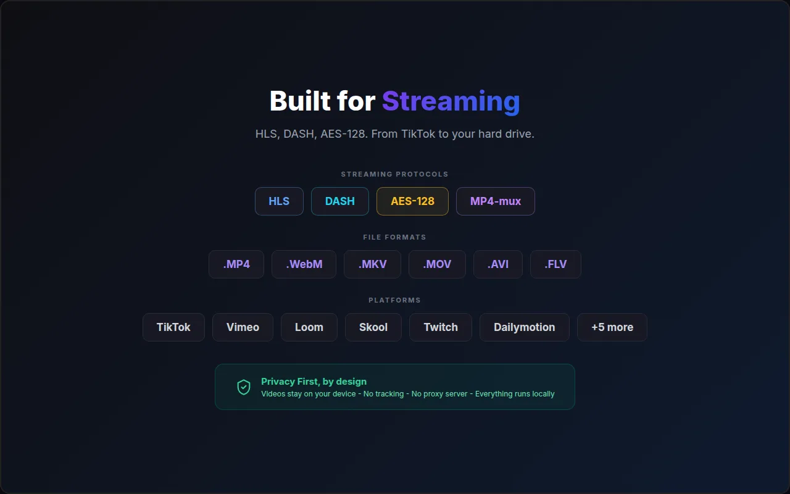

  

<h1 align="center">Vidora</h1>

  <strong>Save the video you are watching, with picture and sound, in one click.</strong> 
  A video downloader extension for Chrome, Edge, Brave and Opera: HLS, DASH, MP4, live streams and online courses.

  <a href="https://chromewebstore.google.com/detail/vidora-video-downloader/pjnnoldljndmfifpnfmbpbehklaaboje?utm_source=github&utm_medium=readme"><strong>Add to Chrome, free</strong></a>
  ·
  <a href="https://github.com/romainGouraud/vidora/discussions">Community</a>
  ·
  <a href="https://github.com/romainGouraud/vidora/issues/new/choose">Report a site or a bug</a>
  ·
  <a href="https://getvidora.com/?utm_source=github&utm_medium=readme">Website</a>

  

## This repository

This is the **public home of the Vidora community**: questions, bug reports, site requests, feature ideas and votes, release notes and the public roadmap. The extension's source code is not published here.

| You want to | Go to |
|---|---|
| Ask how to save a video from a site | [Q&A](https://github.com/romainGouraud/vidora/discussions/categories/q-a) |
| Suggest a feature, or vote for one | [Ideas](https://github.com/romainGouraud/vidora/discussions/categories/ideas) (add a 👍 to the ideas you want first) |
| Tell us a site does not work | [Request a site](https://github.com/romainGouraud/vidora/issues/new?template=site-request.yml) |
| Report a bug | [Bug report](https://github.com/romainGouraud/vidora/issues/new?template=bug-report.yml) |
| Know what is coming | [Roadmap](ROADMAP.md) and [Announcements](https://github.com/romainGouraud/vidora/discussions/categories/announcements) |
| Get notified of new versions | Click **Watch → Custom → Releases** at the top of this page |
| Report a security issue | [Security policy](SECURITY.md), privately, never in a public issue |

Prefer to stay private? Use **Report a problem** inside the extension, or write to support@getvidora.com. Both reach the same person.

## What Vidora does

- **Detects the videos on the page** you are watching (network and page scanning) and lists them with quality, size and duration.
- **HLS (.m3u8) and DASH (.mpd)** streams saved as one MP4 with picture and sound, in the original quality, without re-encoding. AES-128 encrypted HLS is supported.
- **Live streams** are recorded until you press Stop, with a maximum duration you choose.
- **Capture while playing** for players that hide their stream: Vidora records what the player itself loads.
- **Whole courses on Skool**: tick the lessons and Vidora saves them one after the other, in numbered folders.
- **Formats**: MP4, MKV when an MP4 would need re-encoding, audio only (including MP3), subtitles as VTT or SRT.
- **Your own file names** with a template ({title}, {site}, {date}, {quality}...), and folders.
- **Preview and copy**: play a few seconds before downloading, or copy the video link, a ready ffmpeg command or a yt-dlp command.
- **30 languages**, no account, no ads.

The honest compatibility list, with the reason when a site does not work, is on [getvidora.com/supported-sites](https://getvidora.com/supported-sites?utm_source=github&utm_medium=readme).

  

## Frequent questions

- [Vidora does not detect any video on the page](https://github.com/romainGouraud/vidora/discussions/6)
- [My downloaded video has no sound](https://github.com/romainGouraud/vidora/discussions/7)
- [A download fails or stops before the end](https://github.com/romainGouraud/vidora/discussions/8)
- [How do I save a whole course on Skool?](https://github.com/romainGouraud/vidora/discussions/9)
- [How do I record a live stream?](https://github.com/romainGouraud/vidora/discussions/10)
- [Does Vidora work on Edge, Brave, Opera or Firefox?](https://github.com/romainGouraud/vidora/discussions/11)

## What Vidora will never do

- **YouTube**: not supported, by Chrome Web Store policy.
- **DRM** (Netflix, Disney+, Prime Video, Widevine-protected courses): refused. Vidora does not break copy protection, and requests to do so are closed.
- **Your data**: videos are processed in your browser and never uploaded. Anonymous usage counts and error reports contain no page address, no video title and no account information, and can be switched off in Settings. Details: [privacy promise](https://getvidora.com/privacy-promise).

Only download videos you have the right to keep.

## Pricing

Vidora is **free during the launch period, with every feature unlocked**. Paid plans will be announced before the launch period ends, and community members will hear about them first in [Announcements](https://github.com/romainGouraud/vidora/discussions/categories/announcements).

## Free online tools

No install needed: [M3U8 tester](https://getvidora.com/tools/m3u8-tester/), [M3U8 to MP4 converter](https://getvidora.com/tools/m3u8-to-mp4-converter/), [M3U8 detector](https://getvidora.com/tools/m3u8-detector/), [DASH MPD analyzer](https://getvidora.com/tools/dash-mpd-analyzer/), [TS to MP4](https://getvidora.com/tools/ts-to-mp4-converter/), [VTT to SRT](https://getvidora.com/tools/vtt-to-srt-converter/). See [all tools](https://getvidora.com/tools/).

Command line? [m3u8-doctor](https://github.com/romainGouraud/m3u8-doctor) explains any HLS stream in plain words and prints the ffmpeg command that keeps the sound (open source).

## Founding contributors: Vidora free for life

Tell us what you need. **If your site request, bug report, idea or translation fix ships in a release before the paid plans start, you get Vidora free for life**, with every paid feature. Details in [CONTRIBUTING.md](CONTRIBUTING.md#founding-contributors-vidora-free-for-life), and the list in [CONTRIBUTORS.md](CONTRIBUTORS.md).

## Help the project

- **Leave a review** on the [Chrome Web Store](https://chromewebstore.google.com/detail/vidora-video-downloader/pjnnoldljndmfifpnfmbpbehklaaboje/reviews?utm_source=github&utm_medium=readme): it is the single thing that helps Vidora most.
- **Star this repository** so more people find it.
- **Report the sites that fail**: every report with clear steps is reproduced, and fixed whenever it is technically possible and not DRM.
- **Improve a translation**: see [CONTRIBUTING.md](CONTRIBUTING.md).

Made by [Romain Gouraud](https://getvidora.com/about?utm_source=github&utm_medium=readme). Release notes: [CHANGELOG](https://getvidora.com/changelog/?utm_source=github&utm_medium=readme) and [Releases](https://github.com/romainGouraud/vidora/releases).
